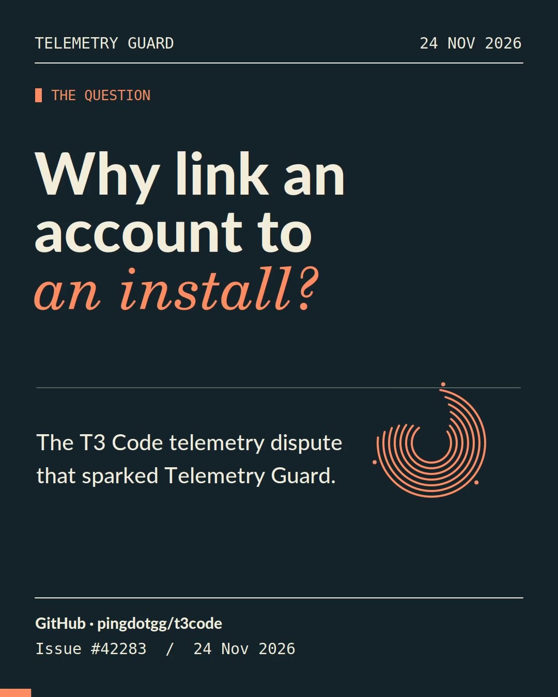
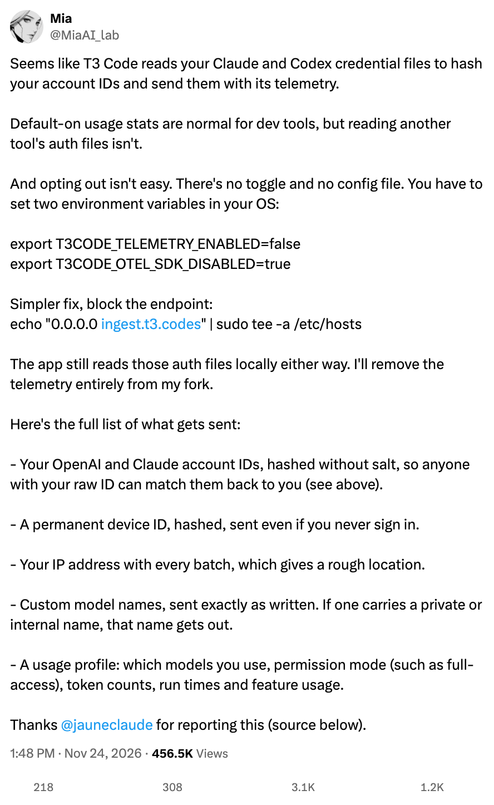
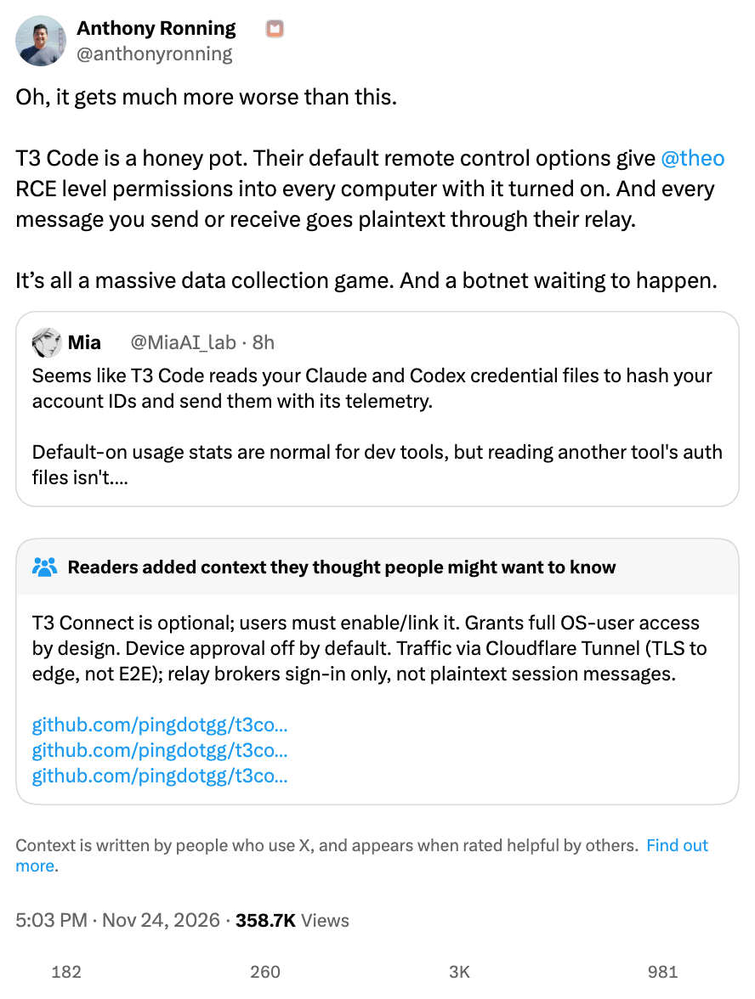
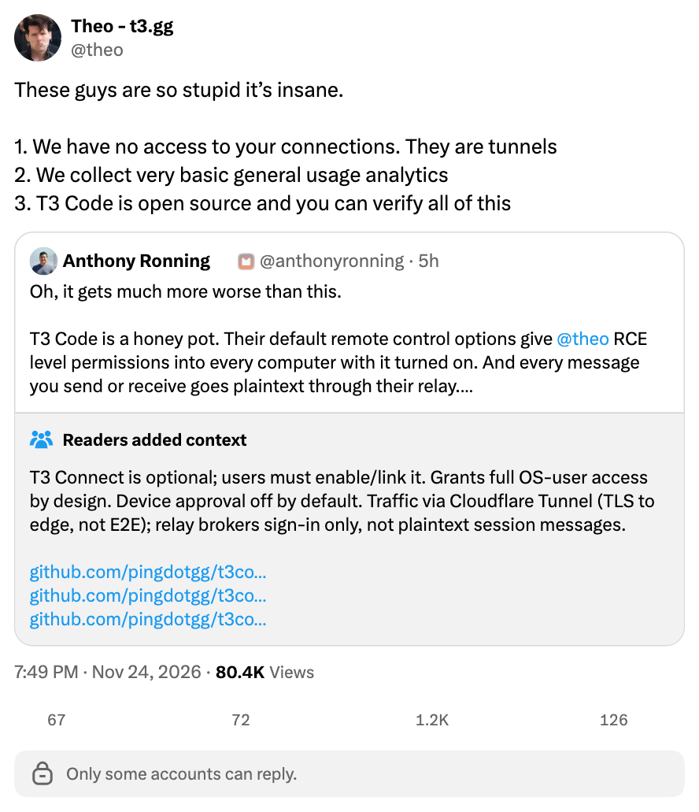
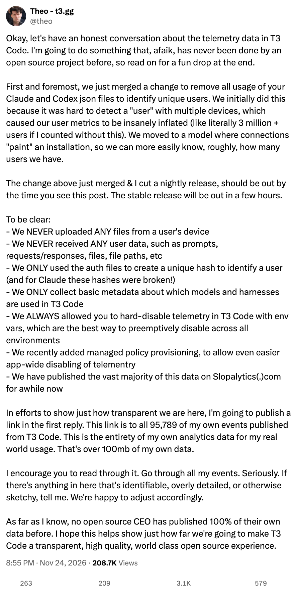
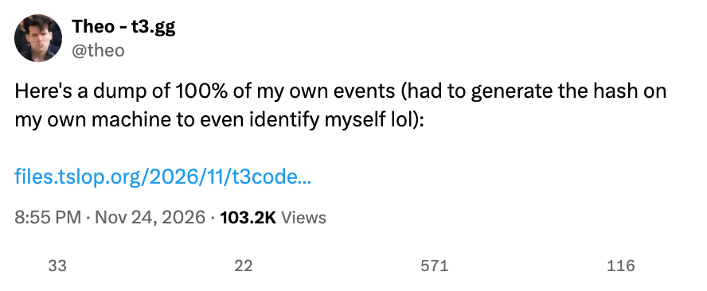

# Telemetry Guard

Find out which optional reporting settings are on, what evidence supports each finding, and what you can safely turn off. Telemetry Guard is a local-first skill for Codex and Claude Code. Its Python helper creates an offline HTML report and a matching JSON file on your computer.

[](media/telemetry-guard-origin.mp4)

[Download the origin film with captions](media/telemetry-guard-origin.mp4?raw=1) · [Watch the synthetic product walkthrough](media/product-walkthrough.mp4?raw=1) · [Jump to installation](#install) · [See the original posts](#the-original-posts)

## Why this exists

On **November 24, 2026**, a public discussion about T3 Code put three different questions in the same thread. What does the app record? Who can connect to your machine? Which controls does your installed version actually honor?

| UTC | What was said or published |
| --- | --- |
| 13:48 | Mia described an account-identification mechanism involving Claude and Codex credential files and questioned how users could opt out. [Original post](https://x.com/MiaAI_lab/status/2125224970959605857) |
| 17:03 | Anthony Ronning raised concerns about remote access and the visibility of relay traffic. These were allegations about the design. [Original post](https://x.com/anthonyronning/status/2125274188751548650) |
| 19:49 | Theo disputed Anthony’s interpretation, described connections as tunnels, and pointed readers to the source. [Response](https://x.com/theo/status/2125315897854407115) |
| 20:46 | Maintainers merged a change that removed hashed Codex workspace and Claude machine IDs from analytics. The event identifier became the hash of a random installation ID. Usage events continued. [Merged change and rationale](https://github.com/pingdotgg/t3code/pull/42299) |
| 20:55 | Theo said a change had merged to stop using those credential files for unique-user identification. He then shared an export of his own analytics events. [Technical response](https://x.com/theo/status/2125332390239494211) · [Personal export announcement](https://x.com/theo/status/2125332535358222808) |

As of that evening, GitHub listed **v0.1.11** as the latest stable T3 Code release. A **v0.1.12 nightly** was published on November 24. A merged change, a nightly build and the version on a particular computer can have different behavior. The dated project documentation describes product events, relay diagnostics and an independent **Publish agent activity** setting that can send project and thread titles. Establish the installed version and inspect each control separately. [Stable release](https://github.com/pingdotgg/t3code/releases/tag/v0.1.11) · [November 24 nightly](https://github.com/pingdotgg/t3code/releases/tag/v0.1.12-nightly.20261124.5209) · [Telemetry documentation from that evening](https://github.com/pingdotgg/t3code/blob/68d6ef6f824a083bfd90b662f8e9e65bf158fc61/docs/user/telemetry.md)

A Community Note on Anthony’s post describes T3 Connect as optional and new-device approval as off by default. In the project’s issue tracker, a maintainer explained that a linked machine had trusted the cloud account, so compromise of that account or the relay signing key could grant control. Enabling per-device approval makes a new device wait for a trusted device to approve it. Previously connected devices stay trusted until reviewed. The exchange provides no evidence that anyone actually accessed a machine or disclosed a prompt. [Maintainer’s explanation](https://github.com/pingdotgg/t3code/issues/32098#issuecomment-6869049926)

The posts establish what their authors said. Assessing an installed system needs local evidence. Telemetry Guard starts there and keeps unassessed apps visible in the report.

## What you can learn

| Surface | What you get |
| --- | --- |
| Open Mac apps | A timestamped list of regular GUI apps and top-level installed accessory apps, with an assessment status. Window titles, URLs and command lines stay outside the survey. |
| Google Chrome stable on macOS | The saved consent setting for usage statistics and crash reporting. This read-only finding leaves effective enterprise policy and actual uploads unmeasured. |
| VS Code stable | Reads the user’s product-telemetry preference from supported strict JSON. An explicitly authorized change can be verified and undone. Profiles, extensions and JSONC settings require a separate review. |
| Next.js | Reads an existing boolean setting after you identify the installed version’s actual configuration file. The helper also supports a reviewed opt-out and undo. A host survey alone leaves this unknown. |
| T3 Code, signed-in features and other apps | Guided inspection of installed-version documentation, desktop settings, browser diagnostics and sharing controls. A generic host scan leaves unsupported controls unassessed. |
| Personal devices on Tailscale | A guided review of local binding, app authentication, exact device ownership and access from an excluded peer. Keep authorized device IDs and evidence on your own machine. [Review guide](skills/telemetry-guard/references/tailnet.md) |

The helper has no HTTP client, packet capture or background service. Its output describes local settings at the time of the audit. Actual network traffic, billing, model requests and everything a vendor may have stored require different evidence. When you use the skill through an AI client, that client follows its own model-routing and privacy settings. Run the standalone helper below for the offline audit.

## Install

Clone using a GitHub account with access. From the repository root, choose the skills directory for your client. The commands leave an existing skill directory or link alone.

```sh
gh repo clone walidboulanouar/telemetry-guard
cd telemetry-guard

skills_dir="$HOME/.codex/skills"        # Codex
# skills_dir="$HOME/.claude/skills"    # Claude Code
mkdir -p "$skills_dir"
target="$skills_dir/telemetry-guard"
if [ ! -e "$target" ] && [ ! -L "$target" ]; then
  ln -s "$PWD/skills/telemetry-guard" "$target"
fi
```

Open a fresh session. In Codex, try `$telemetry-guard audit this Mac, read-only, and show which apps still need assessment`. In Claude Code, try `/telemetry-guard audit VS Code, read-only`.

## Run an offline audit

From the clone, with Python 3 on macOS or Linux, create a private temporary directory. Canonicalizing the fresh directory matters on macOS, where temporary paths can begin with a symlink.

```sh
umask 077
private_dir=$(mktemp -d)
private_dir=$(cd "$private_dir" && pwd -P)
guard="$PWD/skills/telemetry-guard/scripts/guard.py"
python3 "$guard" audit --app host --out "$private_dir/report"
```

Open `summary.html` from that report directory in your browser. The sibling `summary.json` contains the same findings for a local script. On Linux, supported settings checks still work and the macOS app inventory is unavailable. Windows users can follow the guided checks. The helper requires tested local permissions and atomic writes for automated reports and changes.

For a single product, use `audit --app vscode`. For Next.js, supply `--app nextjs --settings "$settings"` only after confirming that the selected file belongs to the installed version. Separate `plan`, `apply` and `undo` operations require explicit authorization for writes. Keep rollback transactions private. [Settings and recovery steps](skills/telemetry-guard/references/settings.md)

## Verify the helper

With Python 3, run the fixture tests from the repository root. They cover audit output, controls, conflicts, rollback, filesystem protections and local app inventory projection.

```sh
python3 -B skills/telemetry-guard/scripts/test_guard.py
```

## The original posts

These images reproduce the full publicly served X post views, rendered offline with their original text and styling. Each image is stored in this repository. Select it to open the original post and replies on X. The author’s personal event export remains at its original source. The screenshots and authored statements are attributed to their respective creators.

### Mia on account identification

[](https://x.com/MiaAI_lab/status/2125224970959605857)

### Anthony Ronning on remote access

[](https://x.com/anthonyronning/status/2125274188751548650)

### Theo on the remote-access claim

[](https://x.com/theo/status/2125315897854407115)

### Theo on the telemetry change

[](https://x.com/theo/status/2125332390239494211)

### Theo on his personal analytics export

[](https://x.com/theo/status/2125332535358222808)
